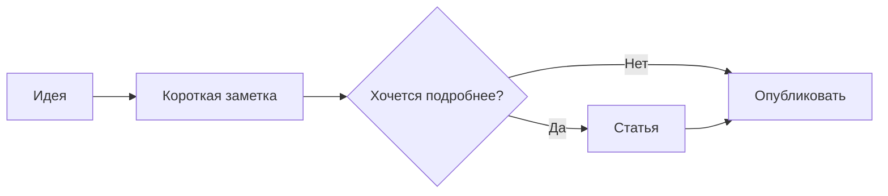

Эта статья — живая шпаргалка по оформлению. Здесь можно посмотреть результат, скопировать синтаксис в редактор и попробовать его в своей записи. **Спойлеры и зачёркивание есть.**

[Текст](#выделение-текста) · [Спойлеры](#спойлеры) · [Списки](#списки) · [Таблица](#таблицы) · [Медиа](#изображения-и-подписи) · [Сноски](#сноски) · [Возможности записи](#кроме-оформления)

## Выделение текста

**Жирный** для акцента, *курсив* для интонации и ~~зачёркнутый текст~~ для исправления. Можно сочетать **жирный и *курсив внутри***. Короткие команды удобно писать так: `go run ./cmd/blog serve`.

```markdown
**Жирный**
*Курсив*
~~Зачёркнутый текст~~
**Жирный и *курсив внутри***
`код в строке`
```

Поддерживается и безопасный HTML: <u>подчёркнутый текст</u>, вода H<sub>2</sub>O, квадрат x<sup>2</sup> и <mark>выделение маркером</mark>.

```html
<u>Подчёркивание</u>
H<sub>2</sub>O и x<sup>2</sup>
<mark>Маркер</mark>
```

## Спойлеры

Ответ скрыт здесь: [? сорок два ?]. Наведи указатель или переведи фокус клавишей Tab; на телефоне коснись скрытого текста.

```markdown
Ответ скрыт здесь: [? сорок два ?].
```

Внутри спойлера работает Markdown: [? **жирный**, *курсив*, ~~зачёркнутый~~, `код` и [ссылка](/) ?]. Спойлер скрывает текст визуально — он остаётся в исходнике страницы и в Markdown-версии.

Для длинного ответа есть раскрывающийся блок:

<details>
<summary>Нажми, чтобы прочитать длинный ответ</summary>

Здесь помещаются несколько абзацев, **выделение** и список:

- короткий ответ — можно;
- подробный ответ — тоже можно.

</details>

```html
<details>
<summary>Заголовок раскрывающегося блока</summary>

Текст и **Markdown**. Оставь пустые строки вокруг текста.

</details>
```

## Заголовки и ссылки

Уровни заголовков задаются символами `#`. Название статьи уже служит главным заголовком, поэтому разделы текста обычно начинаются с `##`.

### Подраздел — третий уровень

#### Четвёртый уровень

##### Пятый уровень

###### Шестой уровень

```markdown
## Раздел
### Подраздел
#### Уточнение
##### Пятый уровень
###### Шестой уровень
```

Заголовки получают якоря. Например, [вернуться к выделению текста](#выделение-текста). Ещё есть [обычная ссылка на главную](/), ссылки с [подсказкой](/all/ "Открыть архив") и автоматические ссылки: https://example.org.

```markdown
[На главную](/)
[Подсказка](/all/ "Открыть архив")
[К разделу](#выделение-текста)
https://example.org
```

## Списки

- Первый пункт.
- Второй пункт с **выделением**.
    - Вложенный пункт.
    - Ещё один вложенный пункт.

1. Написать текст.
2. Проверить предпросмотр.
3. Опубликовать.

Список задач показывает состояние, заданное автором. Галочки здесь не переключаются читателем:

- [x] Написать заголовок.
- [x] Добавить примеры.
- [ ] Заменить демонстрационный текст своим.

```markdown
- Пункт
    - Вложенный пункт

1. Первый шаг
2. Второй шаг

- [x] Готово
- [ ] Пока нет
```

## Цитаты

> Интернет интереснее, когда у людей есть собственные места для разговора.
>
> Цитата может состоять из нескольких абзацев.

```markdown
> Текст цитаты.
>
> Второй абзац.
```

Отдельная короткая выноска записывается с `%` в начале строки:

```text
% Хорошая мысль заслуживает собственного адреса.
```

% Хорошая мысль заслуживает собственного адреса.

## Таблицы

| Приём | Запись | Результат |
| --- | --- | --- |
| Акцент | `**важно**` | **важно** |
| Исправление | `~~раньше~~` | ~~раньше~~ |
| Команда | `` `go test` `` | `go test` |

```markdown
| Название | Значение |
| --- | --- |
| Строка | Текст |
```

На небольшом экране широкую таблицу можно прокручивать по горизонтали.

## Код

Блок кода сохраняет пробелы и переносы. Можно указать язык после открывающих трёх обратных кавычек. Укажите язык блока, чтобы включить цветную подсветку синтаксиса: например, `go`, `python`, `javascript`, `json`, `bash` или `css`. Неизвестный язык остаётся обычным текстом.

```go
package main

import "fmt"

func main() {
    fmt.Println("Привет, личный интернет!")
}
```

Четыре обратные кавычки позволяют показать пример с тройными внутри:

````markdown
```go
fmt.Println("Привет!")
```
````

## Текст в отдельном блоке

Многострочный `[[[ … ]]]` оформляет текст отдельной панелью и добавляет ссылку на обсуждение фрагмента. Открывающий и закрывающий маркеры нужно писать на отдельных строках.

```text
[[[
Здесь **важный абзац** и ссылка на обсуждение.
]]]
```

[[[
Здесь **важный абзац** и ссылка на обсуждение. Можно обсудить именно этот фрагмент: комментарии появятся под статьёй с привязкой к нему.
]]]

## Изображения и подписи

У изображения есть альтернативный текст и необязательная подпись в кавычках. Если подпись не указана, под изображением показывается альтернативный текст.

```markdown

```


Медиаблок собирает изображения и другие элементы в отдельную секцию:

```text
{{{

}}}
```

{{{

}}}

## Видео

Ссылка на MP4 или WebM в синтаксисе изображения превращается в видеоплеер. Здесь короткий локальный тестовый ролик без звука — нажми воспроизведение.


```markdown


```

YouTube тоже поддерживается: ``, где вместо `ID_РОЛИКА` нужен настоящий 11-символьный идентификатор. Появится встроенный плеер. В этой шпаргалке внешнего ролика нет.

## Сноски

К утверждению можно добавить пояснение[^example]. Ещё одна ссылка на ту же сноску[^example].

[^example]: Это текст сноски. В нём работают **выделение** и [ссылки](/). Обратная ссылка возвращает к месту чтения.

```markdown
Пояснение к утверждению[^example].

[^example]: Текст сноски.
```

## Разделители и переносы

Горизонтальный разделитель записывается как `---` на отдельной строке с пустыми строками вокруг:

---

Эта строка первая.
Эта строка вторая: обычный перенос строки здесь сохраняется.

Новый абзац отделяется пустой строкой. Чтобы показать символы Markdown буквально, экранируй их: \*это не курсив\*.

## Диаграммы Mermaid

Блок с языком `mermaid` превращается в диаграмму с рисованными линиями в духе Excalidraw и тёмной темой. Ниже можно раскрыть её исходник. При отключённом JavaScript остаётся сам код.



Кнопка «Диаграмма Mermaid» в редакторе вставляет начальный пример. Рисованный вид применяется к тем типам диаграмм, для которых его поддерживает Mermaid.

## HTML и скрипты

Исполняемый HTML пишется в блоке с языком `embed`. Внутри работают обычный HTML, стили, inline-скрипты и внешние скрипты по HTTP/HTTPS. Блок изолирован от страницы блога: его скрипты не могут читать сессию, менять меню или обращаться к DOM родительской страницы.

```embed
<h3>Небольшой интерактивный пример</h3>
<p>Кнопку нажали <strong id="count">0</strong> раз.</p>
<button id="increment">Прибавить один</button>
<script>
let count = 0;
document.querySelector('#increment').onclick = () => {
  document.querySelector('#count').textContent = ++count;
};
</script>
```

Чтобы вставить этот пример, нажмите «HTML со скриптом» в редакторе. Обычный блок `html` показывает исходник, а `embed` исполняет его. Скрипты вне `embed` по-прежнему не запускаются на самой странице блога.

Внешнюю страницу можно встроить обычным iframe:

```html
<iframe src="https://example.org/" title="Внешняя страница" height="400"></iframe>
```

Разрешены HTTP/HTTPS-адреса; рамка получает изоляцию автоматически. Сайт-источник может запрещать встраивание своими заголовками. В таком случае вместо iframe используйте карточку ссылки.

## Карточки внешних страниц

В редакторе вставьте URL в «Превью внешней страницы» и нажмите «Вставить карточку». Блог загрузит название, описание и обложку из метаданных страницы. Полученная карточка сохранится прямо в тексте записи; для её обновления вставьте ссылку заново.

Если сайт не отдаёт метаданные или блокирует запрос, можно оставить обычную Markdown-ссылку. Превью доступны для публичных HTML-страниц; локальные адреса и внутренние сервисы не загружаются.

## Загрузка изображений

В редакторе есть «Вставить изображение» и «Загрузить обложку». Картинку также можно перетащить в поле текста или вставить из буфера обмена. После загрузки появляется адрес файла; сохраните запись, чтобы закрепить его в тексте или обложке.

В профиле кнопка «Загрузить аватар» работает так же. Поддерживаются JPEG, PNG, GIF и WebP до 10 МБ и 24 мегапикселей. Изображения хранятся в базе блога и доступны по прямой ссылке.

## Кроме оформления

У записи можно задать обложку, подзаголовок, адрес, язык, автора и описание для ссылок. В редакторе доступны черновик, дата будущей публикации, вывод на главную, доступ только участникам и включение комментариев. Для особого оформления есть CSS записи и режим очищенного HTML.

Под статьёй можно оставлять комментарии, отвечать, поддерживать комментарии голосом. Владелец может удалять и закреплять их. Для текстовых блоков доступна привязка обсуждения к фрагменту. Чтобы попробовать комментарии, нужен вход.

Статьи можно читать через [RSS](/rss/) и [JSON Feed](/feed.json). Вверху этой страницы есть ссылка **Markdown** — чистый текст с автором, датами и адресом оригинала. [Путеводитель для ИИ](/llms.txt) ведёт к открытым записям; в HTML каждой открытой статьи есть метаданные `BlogPosting`.

Отдельного оформления формул LaTeX пока нет. Mermaid, подсветка кода и интерактивные HTML-блоки требуют JavaScript. В Markdown-экспорте диаграммы и embed-блоки остаются исходным текстом. В комментариях доступен обычный Markdown, без HTML и специальных блоков статьи.
